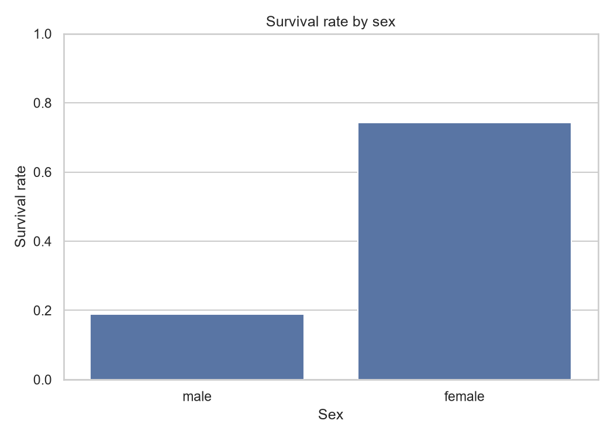
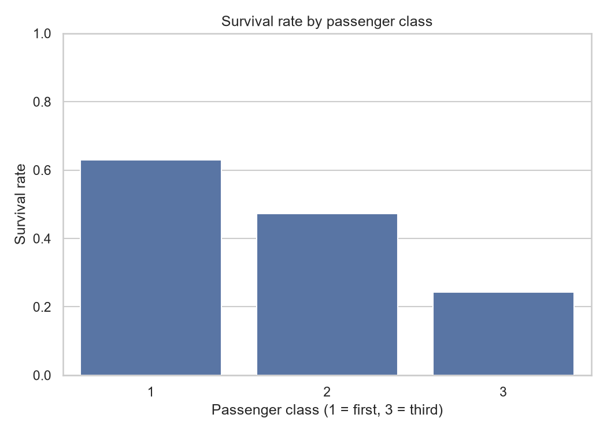
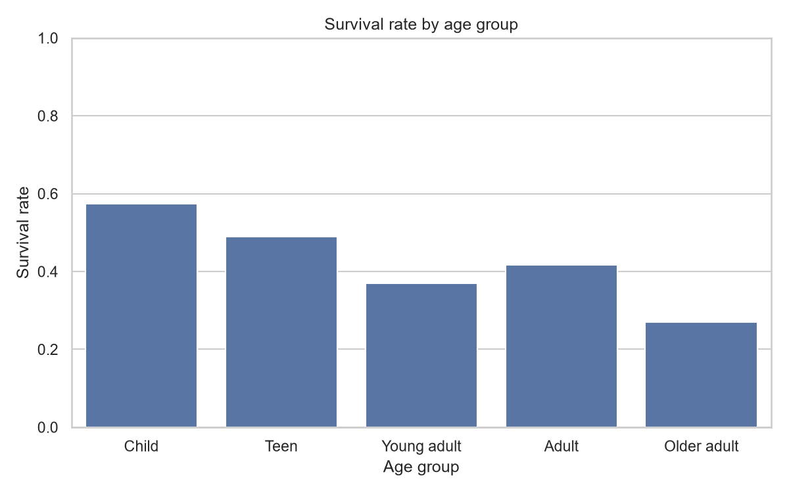
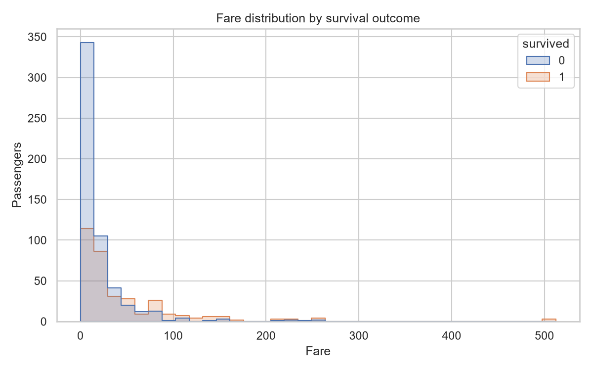
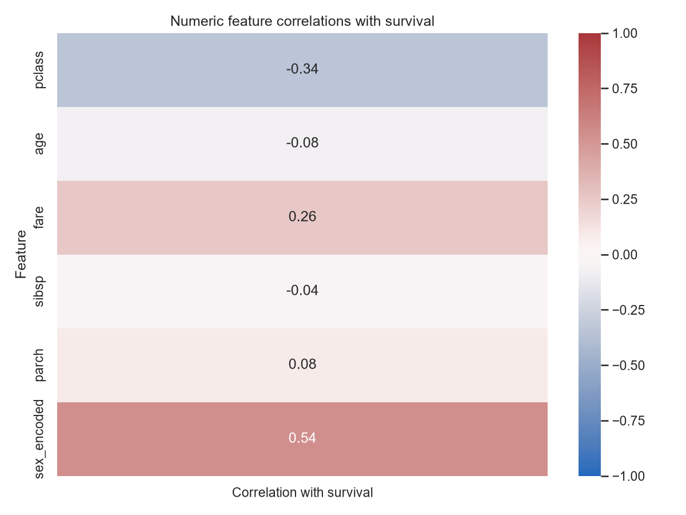

# Titanic Passenger EDA

## Dataset and method

- **Observations:** 891 passengers; **variables:** 15.
- **Outcome:** `survived` (1 = survived, 0 = did not survive).
- **Overall survival rate:** 38.4%.
- **Source:** [seaborn-data Titanic CSV](https://github.com/mwaskom/seaborn-data/blob/master/titanic.csv).
- Rates below are descriptive comparisons, not evidence that a feature caused an outcome.

## Statistical summary

| Measure | Age | Fare | Siblings/spouses aboard | Parents/children aboard |
|---|---:|---:|---:|---:|
| Count | 714 | 891 | 891 | 891 |
| Mean | 29.70 | 32.20 | 0.52 | 0.38 |
| Median | 28.00 | 14.45 | 0.00 | 0.00 |
| Standard deviation | 14.53 | 49.69 | 1.10 | 0.81 |

### Missing values

| Column | Missing | Share of rows |
|---|---:|---:|
| deck | 688 | 77.2% |
| age | 177 | 19.9% |
| embarked | 2 | 0.2% |
| embark_town | 2 | 0.2% |

Age is missing for a subset of passengers, so age-group comparisons use only rows with a recorded age. Missing values are not imputed for this descriptive analysis.

## Survival comparisons

### By sex

| Sex | Passengers | Survival rate |
|---|---:|---:|
| female | 314 | 74.2% |
| male | 577 | 18.9% |

Women survived at 74.2%, compared with 18.9% for men in this dataset.

### By passenger class

| Class | Passengers | Survival rate |
|---|---:|---:|
| 1 | 216 | 63.0% |
| 2 | 184 | 47.3% |
| 3 | 491 | 24.2% |

The first-class survival rate was 63.0%; the third-class rate was 24.2%.

### By age group

| Age group | Passengers with age recorded | Survival rate |
|---|---:|---:|
| Child | 68 | 57.4% |
| Teen | 45 | 48.9% |
| Adult | 209 | 41.6% |
| Young adult | 366 | 36.9% |
| Older adult | 26 | 26.9% |

Age bands are: child (0–11), teen (12–17), young adult (18–34), adult (35–59), and older adult (60+).

## Correlation with survival

Pearson correlations use complete pairs only; sex is encoded as female = 1 and male = 0. They capture linear association and do not adjust for confounding.

| Feature | Correlation |
|---|---:|
| sex_encoded | +0.543 |
| pclass | -0.338 |
| fare | +0.257 |
| parch | +0.082 |
| age | -0.077 |
| sibsp | -0.035 |

The strongest absolute numeric correlation among these encoded/numeric features is **sex_encoded** (+0.543). This is an association, not a causal effect.

## Visualizations

## Takeaways and limitations

1. Survival differed substantially by sex and passenger class in this sample.
2. Fare and passenger class are related descriptors, so their individual associations should not be read as independent effects.
3. Age-based estimates cover fewer passengers because age is missing; the smaller age groups may also be less stable.
4. This is a historical passenger manifest sample, not a randomized experiment or a representative population. These summaries cannot establish why individual passengers survived.
